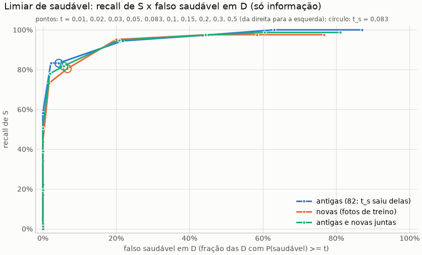

# Validação de campo da regra em duas etapas (passo 5b)

Gerado por `python evaluation/campo_validacao.py`. Modelo congelado (`base_resnet50_bracol`), recorte B, regra já fixada: **limiar de saudável 0,083** (decisão do gestor de 11/10/2026, tirado das 82 folhas antigas) e limiar de doença 0,65 **só como proposta** (run `pipeline_duas_etapas`). Nada foi reajustado com as folhas novas. Rótulos feitos por Claude por leitura visual das pranchas e aceitos pelo gestor em 11/10/2026; não são de especialista. Testes do BRACOL e do BRACOT fechados; nenhum treino.

- **Antigas:** 120 folhas das fotos de validação do detector (36 S, 46 D, 38 "?"). O t_s saiu destas folhas: nelas a medida é otimista.
- **Novas:** 160 folhas, uma por foto, das fotos de treino do detector (41 S, 60 D, 59 "?"). É a validação de verdade da regra. O detector treinou nessas fotos, então as máscaras saem mais limpas que as de fotos novas; mesma lavoura e mesmas 2 sessões das antigas, em cenas diferentes.
- **Desfecho de cada folha:** "saudável", "doença" ou "descartada" (abaixo do corte). Na regra em duas etapas, chamar saudável é P(saudável) >= 0,083 e não depende do limiar de doença.

Conferência: nas 82 antigas, P(saudável) difere no máximo 1.0e-04 do `campo_diagnostico` (passo 5a). Rótulos não casados pela caixa: 0.

## a) Folhas novas: a regra fixada contra o argmax

AUC de P(saudável), S x D: 0,95 (0,89 a 0,99) (bootstrap agrupado por foto; aqui uma folha por foto).

| regra | chamar saudável dado S | chamar saudável dado D | descartada dado S | descartada dado D |
|---|---|---|---|---|
| duas etapas | 80,5% (66,0% a 89,8%; 33 de 41) | 6,7% (2,6% a 15,9%; 4 de 60) | 14,6% (6,9% a 28,4%; 6 de 41) | 56,7% (44,1% a 68,4%; 34 de 60) |
| argmax, corte 0,61 | 0,0% (0,0% a 8,6%; 0 de 41) | 0,0% (0,0% a 6,0%; 0 de 60) | 97,6% (87,4% a 99,6%; 40 de 41) | 61,7% (49,0% a 72,9%; 37 de 60) |
| argmax, sem corte | 19,5% (10,2% a 34,0%; 8 de 41) | 0,0% (0,0% a 6,0%; 0 de 60) | 0,0% (0,0% a 8,6%; 0 de 41) | 0,0% (0,0% a 6,0%; 0 de 60) |

## b) Antigas, novas e juntas

| conjunto | S / D | AUC de P(saudável) (IC 95%) | regra | chamar saudável dado S | chamar saudável dado D |
|---|---|---|---|---|---|
| antigas (82; t_s saiu delas) | 36 / 46 | 0,96 (0,92 a 0,99) | duas etapas | 83,3% (68,1% a 92,1%; 30 de 36) | 4,3% (1,2% a 14,5%; 2 de 46) |
| antigas (82; t_s saiu delas) | 36 / 46 | 0,96 (0,92 a 0,99) | argmax, corte 0,61 | 0,0% (0,0% a 9,6%; 0 de 36) | 0,0% (0,0% a 7,7%; 0 de 46) |
| antigas (82; t_s saiu delas) | 36 / 46 | 0,96 (0,92 a 0,99) | argmax, sem corte | 30,6% (18,0% a 46,9%; 11 de 36) | 0,0% (0,0% a 7,7%; 0 de 46) |
| novas (fotos de treino) | 41 / 60 | 0,95 (0,89 a 0,99) | duas etapas | 80,5% (66,0% a 89,8%; 33 de 41) | 6,7% (2,6% a 15,9%; 4 de 60) |
| novas (fotos de treino) | 41 / 60 | 0,95 (0,89 a 0,99) | argmax, corte 0,61 | 0,0% (0,0% a 8,6%; 0 de 41) | 0,0% (0,0% a 6,0%; 0 de 60) |
| novas (fotos de treino) | 41 / 60 | 0,95 (0,89 a 0,99) | argmax, sem corte | 19,5% (10,2% a 34,0%; 8 de 41) | 0,0% (0,0% a 6,0%; 0 de 60) |
| antigas e novas juntas | 77 / 106 | 0,95 (0,92 a 0,98) | duas etapas | 81,8% (71,8% a 88,8%; 63 de 77) | 5,7% (2,6% a 11,8%; 6 de 106) |
| antigas e novas juntas | 77 / 106 | 0,95 (0,92 a 0,98) | argmax, corte 0,61 | 0,0% (0,0% a 4,8%; 0 de 77) | 0,0% (0,0% a 3,5%; 0 de 106) |
| antigas e novas juntas | 77 / 106 | 0,95 (0,92 a 0,98) | argmax, sem corte | 24,7% (16,4% a 35,4%; 19 de 77) | 0,0% (0,0% a 3,5%; 0 de 106) |

### Sensibilidade do limiar de saudável (só informação, nenhum limiar novo)

| t | antigas (82; t_s saiu delas): recall de S / falso saudável em D | novas (fotos de treino): recall de S / falso saudável em D | antigas e novas juntas: recall de S / falso saudável em D |
|---|---|---|---|
| 0,010 | 100,0% / 87,0% | 97,6% / 76,7% | 98,7% / 81,1% |
| 0,020 | 100,0% / 63,0% | 97,6% / 58,3% | 98,7% / 60,4% |
| 0,030 | 97,2% / 43,5% | 97,6% / 45,0% | 97,4% / 44,3% |
| 0,050 | 94,4% / 21,7% | 95,1% / 20,0% | 94,8% / 20,8% |
| 0,083 | 83,3% / 4,3% | 80,5% / 6,7% | 81,8% / 5,7% |
| 0,100 | 83,3% / 2,2% | 73,2% / 1,7% | 77,9% / 1,9% |
| 0,150 | 58,3% / 0,0% | 43,9% / 0,0% | 50,6% / 0,0% |
| 0,200 | 44,4% / 0,0% | 34,1% / 0,0% | 39,0% / 0,0% |
| 0,300 | 22,2% / 0,0% | 17,1% / 0,0% | 19,5% / 0,0% |
| 0,500 | 0,0% / 0,0% | 2,4% / 0,0% | 1,3% / 0,0% |

## c) Qualidade da rotulagem

Fração de "?" por tipo de folha. "Fragmento" e "brilho" vêm da observação escrita ao rotular (em parte, ela explica o "?"); "borda" e a fração visível vêm da cadeia. Nas novas, o filtro de fragmentos já estava ligado.

| tipo de folha | antigas (82; t_s saiu delas) | novas (fotos de treino) | antigas e novas juntas |
|---|---|---|---|
| fragmento (observação) | 40,0% (25,6% a 56,4%; 14 de 35) | 50,0% (32,6% a 67,4%; 14 de 28) | 44,4% (32,8% a 56,7%; 28 de 63) |
| fração visível < 0,5 (cadeia) | 51,4% (35,6% a 67,0%; 18 de 35) | 0,0% (0,0% a 79,3%; 0 de 1) | 50,0% (34,5% a 65,5%; 18 de 36) |
| borda (cadeia) | 40,5% (30,1% a 51,9%; 30 de 74) | 42,6% (31,6% a 54,5%; 29 de 68) | 41,5% (33,8% a 49,8%; 59 de 142) |
| brilho (observação) | 30,0% (14,5% a 51,9%; 6 de 20) | 31,6% (15,4% a 54,0%; 6 de 19) | 30,8% (18,6% a 46,4%; 12 de 39) |
| nenhum desses | 15,4% (7,2% a 29,7%; 6 de 39) | 33,8% (24,2% a 44,9%; 26 de 77) | 27,6% (20,3% a 36,3%; 32 de 116) |
| todas | 31,7% (24,0% a 40,4%; 38 de 120) | 36,9% (29,8% a 44,6%; 59 de 160) | 34,6% (29,3% a 40,4%; 97 de 280) |

Limites com os "?" tratados como S ou como D (chamar saudável e AUC):

| conjunto | cenário | S / D | AUC | duas etapas: saudável dado S | duas etapas: saudável dado D | argmax 0,61: saudável dado S | argmax 0,61: saudável dado D |
|---|---|---|---|---|---|---|---|
| antigas (82; t_s saiu delas) | sem os "?" | 36 / 46 | 0,96 (0,92 a 0,99) | 83,3% (68,1% a 92,1%; 30 de 36) | 4,3% (1,2% a 14,5%; 2 de 46) | 0,0% (0,0% a 9,6%; 0 de 36) | 0,0% (0,0% a 7,7%; 0 de 46) |
| antigas (82; t_s saiu delas) | "?" como S | 74 / 46 | 0,94 (0,90 a 0,98) | 78,4% (67,7% a 86,2%; 58 de 74) | 4,3% (1,2% a 14,5%; 2 de 46) | 0,0% (0,0% a 4,9%; 0 de 74) | 0,0% (0,0% a 7,7%; 0 de 46) |
| antigas (82; t_s saiu delas) | "?" como D | 36 / 84 | 0,83 (0,75 a 0,89) | 83,3% (68,1% a 92,1%; 30 de 36) | 35,7% (26,3% a 46,4%; 30 de 84) | 0,0% (0,0% a 9,6%; 0 de 36) | 0,0% (0,0% a 4,4%; 0 de 84) |
| novas (fotos de treino) | sem os "?" | 41 / 60 | 0,95 (0,89 a 0,99) | 80,5% (66,0% a 89,8%; 33 de 41) | 6,7% (2,6% a 15,9%; 4 de 60) | 0,0% (0,0% a 8,6%; 0 de 41) | 0,0% (0,0% a 6,0%; 0 de 60) |
| novas (fotos de treino) | "?" como S | 100 / 60 | 0,90 (0,85 a 0,94) | 65,0% (55,3% a 73,6%; 65 de 100) | 6,7% (2,6% a 15,9%; 4 de 60) | 0,0% (0,0% a 3,7%; 0 de 100) | 0,0% (0,0% a 6,0%; 0 de 60) |
| novas (fotos de treino) | "?" como D | 41 / 119 | 0,80 (0,72 a 0,87) | 80,5% (66,0% a 89,8%; 33 de 41) | 30,3% (22,7% a 39,0%; 36 de 119) | 0,0% (0,0% a 8,6%; 0 de 41) | 0,0% (0,0% a 3,1%; 0 de 119) |
| antigas e novas juntas | sem os "?" | 77 / 106 | 0,95 (0,92 a 0,98) | 81,8% (71,8% a 88,8%; 63 de 77) | 5,7% (2,6% a 11,8%; 6 de 106) | 0,0% (0,0% a 4,8%; 0 de 77) | 0,0% (0,0% a 3,5%; 0 de 106) |
| antigas e novas juntas | "?" como S | 174 / 106 | 0,91 (0,88 a 0,95) | 70,7% (63,5% a 76,9%; 123 de 174) | 5,7% (2,6% a 11,8%; 6 de 106) | 0,0% (0,0% a 2,2%; 0 de 174) | 0,0% (0,0% a 3,5%; 0 de 106) |
| antigas e novas juntas | "?" como D | 77 / 203 | 0,81 (0,76 a 0,86) | 81,8% (71,8% a 88,8%; 63 de 77) | 32,5% (26,4% a 39,2%; 66 de 203) | 0,0% (0,0% a 4,8%; 0 de 77) | 0,0% (0,0% a 1,9%; 0 de 203) |

## d) Leitura e recomendação

**Folhas novas (a validação: o t_s não saiu delas).**

| | regra em duas etapas | argmax, corte 0,61 |
|---|---|---|
| chamar saudável dado S | 80,5% (66,0% a 89,8%) | 0,0% (0,0% a 8,6%) |
| chamar saudável dado D | 6,7% (2,6% a 15,9%) | 0,0% (0,0% a 6,0%) |

- **Em S, a diferença é sustentada.** O argmax com 0,61 descarta 40 das 41 S, porque nenhuma
  passa de 0,61. Mesmo sem corte, o argmax só chama saudável 19,5% (10,2% a 34,0%).
- **Em D, os intervalos se tocam**, então a diferença não é sustentada. Mas a estimativa da
  regra (6,7%) passa do teto de 5% usado para fixar o t_s, e o limite superior é 15,9%.
- **A AUC de P(saudável)** é 0,95 (0,89 a 0,99).

**As novas são piores que as 82 antigas nos três números, sem diferença sustentada.**
- O recall de S cai de 83,3% para 80,5%.
- O falso saudável em D sobe de 4,3% para 6,7%.
- A AUC vai de 0,96 para 0,95.
- Os intervalos se sobrepõem bastante. É o esperado de um limiar escolhido nas antigas e medido
  em folhas independentes.
- As máscaras das novas são mais limpas, porque o detector treinou nessas fotos. Isso, se algo,
  favorece as novas, e mesmo assim elas saíram um pouco piores.
- A curva de t_s fica só como informação, e o t_s continua 0,083. Nas novas, 0,10 daria 73,2% /
  1,7%, e 0,05 daria 95,1% / 20,0%.

**Os "?" são a maior incerteza.**
- **Quantos são:** 37% das folhas novas e 32% das antigas.
- **O que a regra faz com eles:** chama saudável 32 dos 59 "?" das novas e 28 dos 38 das
  antigas.
- **Limites, nas novas:**
  - com todos os "?" como D, o falso saudável em D vai a 30,3% (22,7% a 39,0%);
  - com todos como S, o recall de S cai para 65,0%.
- O risco real de chamar saudável uma folha doente depende justamente das folhas ambíguas, que
  estes rótulos (sem especialista) não resolvem.
- **Onde se concentram:** em fragmentos (50% nas novas) e na borda (43%).
- **Mesmo nas folhas sem nenhum desses tipos,** as novas têm 34% de "?", contra 15% nas antigas
  (os intervalos se tocam).

**A 2ª etapa (t_d = 0,65, proposta) não resolve as doenças no campo.**
- Das 60 D novas, 22 saem como doença e 34 são descartadas; o argmax com 0,61 dá 23 e 37.
- A cobertura das doentes fica baixa nas duas regras.

**Recomendação (a decisão é do gestor): ligar a regra por padrão, junto com a decisão do limiar
de doença.**
- **No campo, o padrão atual não chama saudável nenhuma folha.** São 0 das 77 S rotuladas, nos
  dois conjuntos, e toda folha saudável vira `baixa_confianca` ou, raramente, doença. A regra
  fixada chama saudável cerca de 80% das S em folhas independentes.
- **Custo no campo:** cerca de 7% das D evidentes viram saudáveis (até 16% pelo intervalo), e
  possivelmente cerca de 30% se as folhas ambíguas forem doentes.
- **Custo no BRACOL:**
  - fora da dobra, a regra completa fica abaixo do argmax (91,7% contra 95,1%, sustentado);
  - na validação do modelo congelado, a diferença não se sustenta (95,3% contra 96,1%).

Para ligar, faltam três decisões:
1. **O limiar de doença:** 0,65 é a proposta, e sem ele a regra não liga.
2. **A confiança informada das folhas saudáveis:** é P(saudável), por volta de 0,1. Vale
   decidir com o frontend como mostrar esse número, para não aparecer como "10% de confiança"
   num diagnóstico de folha saudável.
3. **Os limites, registrados no README:**
   - o falso saudável foi medido só em D evidentes;
   - os rótulos não são de especialista;
   - é uma lavoura só.

Se um falso saudável acima de 5% for inaceitável, não ligue. Os dados novos não mostram que a
regra respeita os 5% (6,7%, de 2,6% a 15,9%); só não mostram que ela falha.

