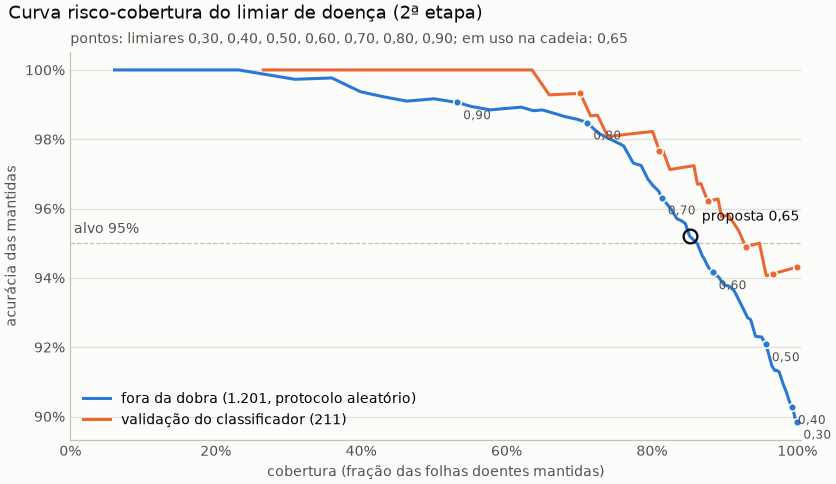

# Inferência ponta a ponta: run `pipeline_duas_etapas`

Gerado por `python model/avaliar_pipeline.py` em 11/10/2026 11:13, no commit `abce598` (com alterações não commitadas). Classificador `model/runs/base_resnet50_bracol`, detector `model/runs/detector_base/weights/last.pt`. **Os testes do BRACOL e do BRACOT não foram lidos nem avaliados.** Módulo: `model/inferencia.py`; interface no README (seção "Interface para o backend").

## Decisões do gestor

- **10/10/2026:** o detector está bom o bastante: AP50 de máscara de 94,7% (região) e 88,1% (conservador), limiar 0,35.
- **10/10/2026:** classificar também as folhas cortadas pela borda, com área mínima e corte por confiança do classificador; reavaliar o filtro de borda olhando os recortes.
- **10/10/2026:** folha única: a foto inteira só se houver detecção com score >= 0,05; sem nenhuma, planta_nao_identificada.
- **10/10/2026:** arquivo_muito_grande acima de ~64 megapixels, com as dimensões lidas do cabeçalho.
- **11/10/2026:** recorte B por padrão (o A continua como opção), pelos rótulos de campo do passo 4.
- **11/10/2026:** filtro de fragmentos ligado com fracao_visivel_minima = 0,5; folha sozinha inteira não é filtrada; se o filtro tirar todas as folhas, baixa_confianca pedindo para enquadrar a folha inteira.
- **11/10/2026:** sem validação cruzada das variantes do passo 4: o modelo oficial segue o base_resnet50_bracol. O limiar de confiança segue pendente.
- **11/10/2026:** base_resnet50_bracol e detector_base congelados como modelos finais, sem retreino final; os testes fechados medem estes modelos uma única vez, no fim.
- **11/10/2026:** regra em duas etapas: o limiar de saudável fica fixado antes de dados novos, com no máximo 5% das D das 82 folhas rotuladas marcadas saudáveis (0,083 no modelo atual, modo B), sem reajuste com dados novos; a regra fica desligada por padrão até a validação.
- **11/10/2026:** os 82 rótulos de campo ficam congelados, inclusive as 3 S com marca na ponta; o ponto de operação sem elas sai só como sensibilidade.

## Configuração da cadeia

| parâmetro | valor | origem |
|---|---|---|
| limiar_deteccao | 0,35 | decisão do gestor |
| max_folhas | 15 | RNF02 (a validação do BRACOT tem até 13 detecções) |
| area_minima | 0,5% | pedido do gestor (cortadas: T2) |
| saturacao_minima / fracao_colorida_minima | 30 / 25% | filtro de cor, medido no treino (abaixo) |
| limiar_confianca | 0,61 | proposta da curva risco-cobertura; **aguarda a decisão do gestor** |
| recorte | B | decisão do gestor (11/10/2026), pelos rótulos de campo do passo 4; no T1 só o recorte acerta 91,2% no A e 86,5% no B (abaixo) |
| margem | 17,0% | medida no treino do BRACOL (abaixo) |
| cinza_fundo | 197 | medido no treino do BRACOL (abaixo) |
| cobertura_folha_unica | 30% | entre o BRACOL e o BRACOT de treino (abaixo) |
| score_minimo_folha_unica | 0,05 | decisão do gestor |
| max_megapixels | 64 | decisão do gestor |
| fracao_visivel_minima | 0,50 | filtro de fragmentos; decisão do gestor (11/10/2026) |
| decisao | duas_etapas | argmax: o padrão; duas_etapas: proposta do passo 5b, desligada por padrão |
| limiar_saudavel | 0,083 | decisão do gestor (11/10/2026): fixado antes de dados novos (abaixo) |
| limiar_doenca | 0,65 | proposta da curva das doenças (abaixo); **aguarda a decisão do gestor** |

## Constantes medidas no treino

**Cinza do fundo.** Mediana do tom da borda de 8% de cada uma das 1.180 imagens de treino do BRACOL, já em 448x224. O tom do fundo identifica a sessão de fotos (checagem de atalho), por isso cada classe pesa igual: cinza neutro 197 (em uso: 197).

| classe | R | G | B | luminância |
|---|---:|---:|---:|---:|
| saudavel | 188 | 184 | 177 | 183 |
| ferrugem | 207 | 202 | 200 | 203 |
| bicho_mineiro | 198 | 195 | 191 | 194 |
| phoma | 211 | 199 | 194 | 201 |
| cercosporiose | 208 | 200 | 196 | 202 |

**Filtro de cor.** Nas fotos de folha sobre fundo liso do BRACOL, o detector também acha pedaços do fundo. Das 373 detecções no limiar nas 200 imagens de treino, 130 têm menos de 25% da máscara com saturação >= 30 e saem (histograma da fração colorida, de 0 a 1 em passos de 0,1: [109, 15, 10, 10, 10, 9, 14, 13, 31, 152]). Nas 450 folhas anotadas de 80 fotos de treino do BRACOT, a fração colorida tem mediana 99,0%, p1 35,3% e mínimo 14,9%; 2 ficariam abaixo do mínimo.

**Margem.** Em 200 imagens de treino do BRACOL (amostra estratificada, semente 42), a maior folha detectada tem comprimento mediano de 74,7% da largura da foto: margem de 17,0% de cada lado (em uso: 17,0%). Detecções por imagem: nenhuma em 10, uma em 148, mais de uma em 42.

**Cobertura da folha única.** A caixa da maior folha cobre de 17,3% a 78,2% da foto no BRACOL (p5 28,6%, mediana 50,1%). Nas 194 fotos de treino do BRACOT (sem a validação), a maior caixa cobre no máximo 61,4% (p95 39,0%), e 0 foto(s) têm uma só folha utilizável. Regra 1 a partir de 30%.

## Limiar de confiança (RF07)

Curva risco-cobertura: com o limiar t, a folha com probabilidade da classe prevista abaixo de t sai da resposta (todas abaixo: `baixa_confianca`). Fonte principal: as 1.432 predições fora da dobra do diagnóstico por blocos (`model/runs/diagnostico_blocos`, protocolo aleatório; acurácia 90,7% sem limiar). Conferência: as 252 imagens de validação no classificador avaliado (imagem inteira, T1).

| limiar | cobertura (fora da dobra) | acurácia das mantidas (IC 95%) | cobertura saudavel | cobertura ferrugem | cobertura bicho_mineiro | cobertura phoma | cobertura cercosporiose | cobertura (val) | acurácia (val) |
|---|---:|---:|---:|---:|---:|---:|---:|---:|---:|
| 0,50 | 95,3% | 93,0% (91,6% a 94,3%) | 98,7% | 95,3% | 92,1% | 98,0% | 91,2% | 97,2% | 94,7% |
| 0,60 | 88,8% | 94,9% (93,5% a 96,0%) | 96,5% | 87,8% | 84,2% | 96,6% | 71,2% | 93,3% | 95,3% |
| 0,61 | 88,1% | 95,1% (93,7% a 96,1%) | 96,1% | 86,9% | 83,6% | 95,9% | 70,4% | 92,1% | 96,1% |
| 0,70 | 81,8% | 97,3% (96,2% a 98,1%) | 93,9% | 80,0% | 75,1% | 92,2% | 58,4% | 88,5% | 96,4% |
| 0,80 | 71,1% | 98,5% (97,6% a 99,1%) | 88,7% | 68,1% | 60,8% | 86,8% | 39,2% | 82,5% | 98,6% |
| 0,90 | 55,3% | 99,2% (98,4% a 99,7%) | 81,4% | 50,3% | 38,9% | 76,4% | 18,4% | 70,6% | 99,4% |
| 0,95 | 38,1% | 99,8% (99,0% a 100,0%) | 64,9% | 32,8% | 21,0% | 57,1% | 7,2% | 60,3% | 100,0% |

**Proposta: 0,61**, o menor limiar em que a acurácia das mantidas fora da dobra chega a 95%. **A decisão é do gestor.**
Em uso nesta avaliação: 0,61. Arquivo: `risco_cobertura.csv`.

## Regra em duas etapas (passo 5b): proposta, desligada por padrão

**1ª etapa:** P(saudável) >= limiar_saudavel faz a folha saudável, sem o corte de confiança. **2ª etapa:** senão, a doença de maior probabilidade com o softmax renormalizado entre as 4 doenças, cortada por limiar_doenca (abaixo dele a folha sai, como hoje). O padrão da cadeia continua o argmax com o limiar de confiança (`inferencia.Configuracao.decisao`).

**Limiar de saudável: 0,083**, fixado pelo gestor em 11/10/2026 antes de dados novos e sem reajuste: no máximo 5% das 46 D do campo rotulado marcadas saudáveis (modelo atual, modo B; `model/runs/campo_diagnostico`). Com >=, 0,083 deixa passar 2 das 46 D; o valor exato da 3ª D (0,08277) deixaria passar 3 (6,5%). O limiar saiu das mesmas folhas em que foi medido.

Sensibilidade (decisão do gestor, 11/10/2026: rótulos congelados, nenhum CSV alterado). Sem as 3 S com marca na ponta (20191208_142146_02, 20191208_142156_03, 20191208_142829_05):

| folhas | S | D | limiar recalculado (no máximo 5% das D) | D com P(saudável) >= 0,083 | recall de S com P(saudável) >= 0,083 |
|---|---:|---:|---|---|---|
| 82 folhas | 36 | 46 | 0,0828 | 4,3% (1,2% a 14,5%; 2 de 46) | 83,3% (68,1% a 92,1%; 30 de 36) |
| sem as 3 S com marca | 33 | 46 | 0,0828 | 4,3% (1,2% a 14,5%; 2 de 46) | 90,9% (76,4% a 96,9%; 30 de 33) |

O limiar recalculado só depende das D, então tirar S não o muda; só o recall de S muda.

### Efeito do limiar de saudável no BRACOL

As 1.432 predições fora da dobra (protocolo aleatório, modelos de 20 épocas, imagem inteira) e as 252 imagens de validação no classificador avaliado (imagem inteira, T1): o argmax contra P(saudável) >= 0,083.

| fonte | regra | doentes marcadas saudáveis (IC 95%) | recall das saudáveis (IC 95%) |
|---|---|---|---|
| fora da dobra | argmax | 1,1% (0,6% a 1,8%; 13 de 1201) | 99,1% (96,9% a 99,8%; 229 de 231) |
| fora da dobra | P(saudável) >= 0,083 | 5,1% (4,0% a 6,5%; 61 de 1201) | 100,0% (98,4% a 100,0%; 231 de 231) |
| validação (imagem inteira) | argmax | 0,0% (0,0% a 1,8%; 0 de 211) | 97,6% (87,4% a 99,6%; 40 de 41) |
| validação (imagem inteira) | P(saudável) >= 0,083 | 1,9% (0,7% a 4,8%; 4 de 211) | 100,0% (91,4% a 100,0%; 41 de 41) |

### Limiar de doença (2ª etapa): curva risco-cobertura nas doentes

Só no BRACOL: as 1.201 folhas doentes das predições fora da dobra (acurácia da doença renormalizada sem corte: 89,8%). Com o limiar t, a doente com probabilidade renormalizada abaixo de t sai. Conferência: as 211 doentes da validação (imagem inteira, T1).

| limiar | cobertura (fora da dobra) | acurácia das mantidas (IC 95%) | cobertura ferrugem | cobertura bicho_mineiro | cobertura phoma | cobertura cercosporiose | cobertura (val) | acurácia (val) |
|---|---:|---:|---:|---:|---:|---:|---:|---:|
| 0,30 | 100,0% | 89,8% (88,0% a 91,4%) | 100,0% | 100,0% | 100,0% | 100,0% | 100,0% | 94,3% |
| 0,40 | 99,3% | 90,3% (88,5% a 91,8%) | 99,6% | 98,8% | 99,3% | 99,2% | 100,0% | 94,3% |
| 0,50 | 95,7% | 92,1% (90,4% a 93,5%) | 96,2% | 93,6% | 98,3% | 92,8% | 96,7% | 94,1% |
| 0,60 | 88,3% | 94,2% (92,6% a 95,4%) | 88,7% | 86,3% | 97,0% | 72,0% | 92,9% | 94,9% |
| 0,65 | 85,2% | 95,2% (93,7% a 96,4%) | 85,4% | 82,4% | 95,6% | 67,2% | 90,0% | 95,8% |
| 0,70 | 81,3% | 96,3% (94,9% a 97,3%) | 81,6% | 78,1% | 93,2% | 60,8% | 87,7% | 96,2% |
| 0,80 | 71,1% | 98,5% (97,4% a 99,1%) | 72,3% | 65,0% | 87,8% | 43,2% | 81,0% | 97,7% |
| 0,90 | 53,2% | 99,1% (98,0% a 99,6%) | 52,8% | 44,1% | 77,4% | 21,6% | 70,1% | 99,3% |

**Proposta: 0,65**, o menor limiar em que a acurácia das doentes mantidas fora da dobra chega a 95% (o mesmo critério da proposta do limiar de confiança). **Não adotada: a decisão é do gestor.**
Em uso nesta avaliação: 0,65. Arquivo: `risco_cobertura_doencas.csv`.

### A regra completa contra o argmax com o limiar de confiança

Todas as predições, saudáveis e doentes: uma saudável com P(saudável) abaixo do limiar vai para a 2ª etapa e conta como erro.

| fonte | regra | acurácia sem corte | cobertura | acurácia das mantidas (IC 95%) | cobertura das saudáveis | cobertura das doentes |
|---|---|---|---|---|---|---|
| fora da dobra | duas etapas (0,083; 0,65) | 88,4% | 89,4% | 91,7% (90,1% a 93,1%; 1174 de 1280) | 100,0% | 87,3% |
| fora da dobra | argmax (0,61) | 90,7% | 88,1% | 95,1% (93,7% a 96,1%; 1199 de 1261) | 96,1% | 86,5% |
| validação (imagem inteira) | duas etapas (0,083; 0,65) | 94,0% | 92,5% | 95,3% (91,7% a 97,3%; 222 de 233) | 100,0% | 91,0% |
| validação (imagem inteira) | argmax (0,61) | 94,8% | 92,1% | 96,1% (92,8% a 97,9%; 223 de 232) | 97,6% | 91,0% |

A regra completa em outros limiares de doença, com o de saudável fixo em 0,083 (cobertura / acurácia das mantidas):

| limiar de doença | fora da dobra | validação (imagem inteira) |
|---|---|---|
| 0,30 | 100,0% / 88,4% | 100,0% / 94,0% |
| 0,40 | 99,6% / 88,6% | 100,0% / 94,0% |
| 0,50 | 96,9% / 89,8% | 98,0% / 93,9% |
| 0,60 | 91,8% / 91,0% | 94,8% / 94,6% |
| 0,65 | 89,4% / 91,7% | 92,5% / 95,3% |
| 0,70 | 86,4% / 92,5% | 91,3% / 95,2% |
| 0,80 | 78,4% / 93,4% | 85,7% / 96,3% |
| 0,90 | 64,8% / 92,8% | 76,6% / 97,4% |

## T1: validação do BRACOL pela cadeia

As 252 imagens de validação do BRACOL (uma folha por foto, rótulo conhecido) pela cadeia inteira e pela imagem inteira, com o mesmo código (`inferencia.classificar`). A folha avaliada é a de maior área. "Só o recorte" desliga a regra 1, para medir o recorte numa folha com rótulo. Regra de decisão: duas_etapas, sem corte; a última coluna aplica o corte (na regra em duas etapas (saudável com P >= 0,083; doença com P renormalizada >= 0,65)).

| variante | com previsão | acurácia (IC 95%) | F1 macro | recall saudavel | recall ferrugem | recall bicho_mineiro | recall phoma | recall cercosporiose | doentes previstas saudáveis | severidade: exata / ±1 | no corte: cobertura / acurácia |
|---|---:|---:|---:|---:|---:|---:|---:|---:|---:|---:|---:|
| imagem inteira (a referência) | 100,0% | 94,0% (90,4% a 96,4%) | 92,0% | 100,0% | 96,2% | 91,4% | 96,2% | 77,3% | 1,9% (0,7% a 4,8%; 4 de 211) | 76,2% / 95,6% | 92,5% / 95,3% |
| cadeia, recorte A | 99,6% | 93,6% (89,9% a 96,0%) | 92,0% | 100,0% | 96,2% | 87,9% | 94,1% | 86,4% | 1,9% (0,7% a 4,8%; 4 de 210) | 75,7% / 95,6% | 93,3% / 95,3% |
| cadeia, recorte B | 99,6% | 92,4% (88,5% a 95,1%) | 91,3% | 100,0% | 92,4% | 86,2% | 94,1% | 90,9% | 2,9% (1,3% a 6,1%; 6 de 210) | 74,9% / 95,2% | 91,7% / 93,9% |
| só o recorte A (sem a regra 1) | 99,6% | 91,2% (87,1% a 94,1%) | 88,1% | 100,0% | 93,7% | 87,9% | 94,1% | 68,2% | 2,4% (1,0% a 5,5%; 5 de 210) | 76,9% / 95,6% | 91,3% / 95,2% |
| só o recorte B (sem a regra 1) | 99,6% | 86,5% (81,7% a 90,1%) | 83,6% | 100,0% | 86,1% | 77,6% | 94,1% | 68,2% | 4,3% (2,3% a 7,9%; 9 de 210) | 75,3% / 94,8% | 87,7% / 92,8% |

**Regras de folha única nas imagens do BRACOL** (cadeia):

- regra 1 (uma folha, caixa com 30% da foto ou mais): 191;
- regra 2 (nenhuma folha utilizável, alguma detecção com cor de folha e score >= 0,05): 12;
- regra 3 (`planta_nao_identificada`): 1;
- pelas detecções: 48, das quais 38 com mais de uma folha.

**Correção das regras depois do T1.** Na primeira rodada, sem o filtro de cor, o detector achava pedaços do fundo liso do BRACOL como folhas: 135 imagens saíam com mais de uma folha, e a regra 1 só pegava 105. O filtro de cor (constantes, acima) tira esses pedaços, e a regra 2 passou a exigir uma detecção com cor de folha, porque um pedaço de fundo não é sinal de folha.

Detecções utilizáveis por imagem: 0: 13, 1: 201, 2: 31, 3: 7; o filtro de cor tirou 173 detecções de fundo. Conferência da imagem inteira com o `predicoes_val.csv` do run: diferença máxima das probabilidades 7.1e-03 (o treino usou AMP), classe prevista igual em 252 de 252. Arquivo: `t1_imagens.csv`.

## T2: validação do BRACOT (sem rótulo de classe)

As 46 fotos de validação do detector (cenas inteiras do treino dos autores): 321 detecções no limiar, 1 cortadas pela área mínima, 2 pelo filtro de cor, 79 pelo filtro de fragmentos, 0 pelo número máximo; 239 folhas classificadas, 117 cortadas pela borda. Planos: {'deteccao': 46}. Classe igual nos dois modos em 35,1% das folhas. Regra de decisão: duas_etapas; corte na regra em duas etapas (saudável com P >= 0,083; doença com P renormalizada >= 0,65); valor de corte: P renormalizada da doença (as saudáveis da 1ª etapa não têm corte).

|  | modo A | modo B |
|---|---:|---:|
| folhas saudavel | 20 | 122 |
| folhas ferrugem | 161 | 67 |
| folhas bicho_mineiro | 23 | 23 |
| folhas phoma | 35 | 23 |
| folhas cercosporiose | 0 | 4 |
| severidade saudavel | 20 | 122 |
| severidade muito_baixa | 35 | 63 |
| severidade baixa | 184 | 54 |
| severidade alta | 0 | 0 |
| severidade muito_alta | 0 | 0 |
| confiança média / mediana | 52,5% / 51,7% | 36,5% / 33,8% |
| mantidas no corte: saudavel | 20 | 122 |
| mantidas no corte: ferrugem | 66 | 24 |
| mantidas no corte: bicho_mineiro | 2 | 4 |
| mantidas no corte: phoma | 2 | 2 |
| mantidas no corte: cercosporiose | 0 | 0 |
| valor de corte abaixo de 0,50 | 38,9% | 22,6% |
| valor de corte abaixo de 0,60 | 54,4% | 34,3% |
| valor de corte abaixo de 0,65 | 62,3% | 36,4% |
| valor de corte abaixo de 0,70 | 68,6% | 39,3% |
| valor de corte abaixo de 0,80 | 79,9% | 42,3% |
| valor de corte abaixo de 0,90 | 88,7% | 47,3% |
| cortadas pela borda: confiança média | 49,6% | 32,9% |
| inteiras: confiança média | 55,4% | 39,9% |
| cortadas pela borda: saem no corte | 59,8% | 24,8% |
| inteiras: saem no corte | 64,8% | 47,5% |
| fotos sem nenhuma folha com valor de corte >= 0,50 (baixa_confianca) | 3 de 46 | 0 de 46 |
| fotos sem nenhuma folha com valor de corte >= 0,60 (baixa_confianca) | 5 de 46 | 1 de 46 |
| fotos sem nenhuma folha com valor de corte >= 0,65 (baixa_confianca) | 7 de 46 | 1 de 46 |
| fotos sem nenhuma folha com valor de corte >= 0,70 (baixa_confianca) | 9 de 46 | 2 de 46 |
| fotos sem nenhuma folha com valor de corte >= 0,80 (baixa_confianca) | 19 de 46 | 4 de 46 |
| fotos sem nenhuma folha com valor de corte >= 0,90 (baixa_confianca) | 28 de 46 | 7 de 46 |

Arquivo: `t2_folhas.csv` (uma linha por folha) e `t2_fotos.csv`.

### Observações escritas à mão (sem imagens no repositório)

**Regra em duas etapas (limiar de saudável 0,083; limiar de doença proposto 0,65) contra o
argmax com 0,61 do `pipeline_padrao_b`.** Mesmos modelos, mesma cadeia (recorte B e filtro de
fragmentos) e mesmas fotos. Nenhum recorte foi olhado neste run, e os rótulos de campo novos
ainda não foram usados.

- **BRACOL, fora da dobra (1.432):** a regra completa fica abaixo do argmax.
  - Acurácia das mantidas: 91,7% (90,1% a 93,1%) contra 95,1% (93,7% a 96,1%), com
    cobertura parecida (89,4% e 88,1%). Os intervalos não se tocam.
  - A causa é a 1ª etapa: P(saudável) >= 0,083 marca 61 das 1.201 doentes como saudáveis
    (5,1%), contra 13 (1,1%) do argmax, e essas folhas não passam por nenhum corte.
  - Com o limiar de saudável fixo, nenhum limiar de doença avaliado (de 0,30 a 0,90) leva a
    regra completa a 95% fora da dobra. O máximo entre eles é 93,4%, com limiar de doença 0,80.
  - Esses modelos de 20 épocas são mais fracos que o run base.
- **BRACOL, validação no modelo congelado:**
  - **Imagem inteira:** 4 de 211 doentes viram saudáveis. No corte, 95,3% contra 96,1% do
    argmax; os intervalos se sobrepõem.
  - **Cadeia B (T1):** sem corte, 92,4% contra 94,0%. Viram saudáveis 6 de 210 doentes, contra
    0 do argmax. No corte, a cobertura fica igual (91,7%) e a acurácia vai de 95,2% para 93,9%.
- **Custo por classe do limiar de doença de 0,65 (fora da dobra):**
  - a cercosporiose mantém só 67,2% das folhas;
  - o bicho-mineiro, 82,4%;
  - a ferrugem, 85,4%;
  - a phoma, 95,6%.
- **Campo (T2, sem rótulo de classe; modo B):**
  - **Saudáveis:** 122 das 239 folhas, contra 24 do argmax.
  - **Doenças:** das 117 folhas que vão para a 2ª etapa, só 30 passam do limiar de doença (24
    ferrugem, 4 bicho-mineiro e 2 phoma); 87 saem.
  - **Fotos em `baixa_confianca`:** 1 de 46, contra 25 com o argmax.
  - Se as 122 saudáveis estão certas, só os rótulos novos dizem.
- **T3:** mediana de 0,89 s e pior caso estimado de 2,39 s, abaixo dos 5 s do RNF02.

## T3: tempo em CPU (RNF02: diagnóstico em até 5 s)

Nesta máquina, em CPU (8 threads do torch), nas 46 fotos de validação do BRACOT (4032x3024), depois de uma passada de aquecimento. Leitura dos pesos dos dois modelos, uma vez ao subir o backend: 0,4 s, com o torch e o ultralytics já importados (o import leva alguns segundos a mais na primeira vez).

| etapa | mediana (s) | máximo (s) |
|---|---:|---:|
| leitura | 0,07 | 0,08 |
| detecção | 0,21 | 0,25 |
| recortes | 0,18 | 0,37 |
| classificação (lote) | 0,42 | 0,97 |
| contrato | 0,00 | 0,00 |
| **total** | 0,89 | 1,54 |

Folhas por foto: mediana 5, máximo 11; 0 fotos passaram de 5 s. Pior caso, com 15 folhas: a classificação leva 1,38 s (máximo 1,52 s), e o total estimado (maior leitura, maior detecção, recortes e classificação de 15 folhas) é 2,39 s. A CPU do backend pode ser mais lenta que esta. Arquivo: `t3_tempos.csv`.

## Acessos à rede

Nenhum: o classificador é montado sem pré-treino e lê só o `melhor.pt`; o detector roda com o modo offline do ultralytics imposto (`detector.importar_ultralytics`).

## Limites

- O limiar de confiança é calibrado em folhas do BRACOL (fundo claro, uma folha por foto); no campo (T2) a confiança é outra, e não há rótulo para medir a acurácia ali.
- As predições fora da dobra vêm de modelos de 20 épocas, mais fracos que o run base: o limiar proposto tende a ser conservador para ele.
- `especie_incorreta` não é produzido: não há dados de outras plantas. Uma foto sem café pode sair como folha de café com confiança alta.
- O T2 não tem rótulo de classe: as observações dos recortes são uma inspeção visual, não uma medida.

