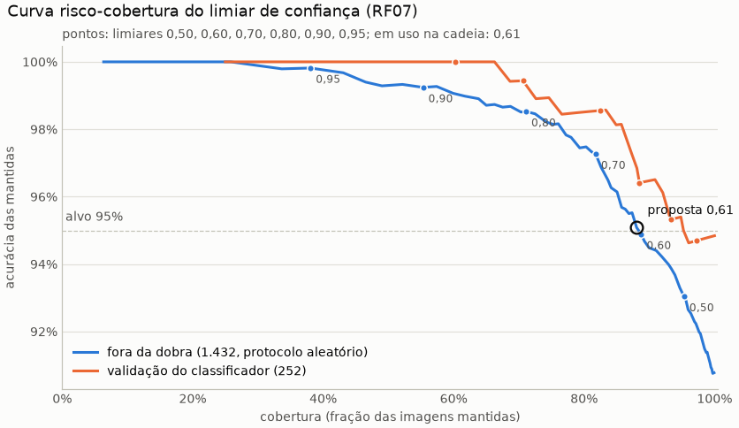

# Inferência ponta a ponta: run `pipeline_final`

Gerado por `python model/avaliar_pipeline.py` em 14/10/2026 11:07, no commit `70d38ee` (com alterações não commitadas). Classificador `model/runs/base_resnet50_bracol`, detector `model/runs/detector_base/weights/last.pt`. **Os testes do BRACOL e do BRACOT não foram lidos nem avaliados.** Módulo: `model/inferencia.py`; interface no README (seção "Interface para o backend").

## Decisões do gestor

- **10/10/2026:** o detector está bom o bastante: AP50 de máscara de 94,7% (região) e 88,1% (conservador), limiar 0,35.
- **10/10/2026:** classificar também as folhas cortadas pela borda, com área mínima e corte por confiança do classificador; reavaliar o filtro de borda olhando os recortes.
- **10/10/2026:** folha única: a foto inteira só se houver detecção com score >= 0,05; sem nenhuma, planta_nao_identificada.
- **10/10/2026:** arquivo_muito_grande acima de ~64 megapixels, com as dimensões lidas do cabeçalho.
- **11/10/2026:** recorte B por padrão (o A continua como opção), pelos rótulos de campo do passo 4.
- **11/10/2026:** filtro de fragmentos ligado com fracao_visivel_minima = 0,5; folha sozinha inteira não é filtrada; se o filtro tirar todas as folhas, baixa_confianca pedindo para enquadrar a folha inteira.
- **11/10/2026:** sem validação cruzada das variantes do passo 4: o modelo oficial segue o base_resnet50_bracol. O limiar de confiança segue pendente.
- **11/10/2026:** base_resnet50_bracol e detector_base congelados como modelos finais, sem retreino final; os testes fechados medem estes modelos uma única vez, no fim.
- **11/10/2026:** regra em duas etapas: o limiar de saudável fica fixado antes de dados novos, com no máximo 5% das D das 82 folhas rotuladas marcadas saudáveis (0,083 no modelo atual, modo B), sem reajuste com dados novos; a regra fica desligada por padrão até a validação.
- **11/10/2026:** os 82 rótulos de campo ficam congelados, inclusive as 3 S com marca na ponta; o ponto de operação sem elas sai só como sensibilidade.
- **11/10/2026:** passo 6, cadeia final: a regra em duas etapas fica ligada por padrão só nos recortes por detecção (modo B), com limiar de saudável 0,083 e limiar de doença 0,65 (provisório); as regras de foto inteira (folha única) continuam no argmax com corte 0,61.
- **11/10/2026:** passo 6: nenhum limiar é reajustado com dados de campo.
- **11/10/2026:** passo 6: as limitações de campo ficam registradas no relatório e nos READMEs (rótulos de Claude sem especialista, uma lavoura e duas sessões, falso saudável nas D evidentes, folhas ambíguas, classe da doença e severidade não verificadas no campo).

## Configuração da cadeia

| parâmetro | valor | origem |
|---|---|---|
| limiar_deteccao | 0,35 | decisão do gestor |
| max_folhas | 15 | RNF02 (a validação do BRACOT tem até 13 detecções) |
| area_minima | 0,5% | pedido do gestor (cortadas: T2) |
| saturacao_minima / fracao_colorida_minima | 30 / 25% | filtro de cor, medido no treino (abaixo) |
| limiar_confianca | 0,61 | curva risco-cobertura (abaixo); vale na foto inteira e no modo A: decisão do gestor (11/10/2026, passo 6) |
| recorte | B | decisão do gestor (11/10/2026), pelos rótulos de campo do passo 4; no T1 só o recorte acerta 92,4% no A e 86,5% no B (abaixo) |
| margem | 17,0% | medida no treino do BRACOL (abaixo) |
| cinza_fundo | 197 | medido no treino do BRACOL (abaixo) |
| cobertura_folha_unica | 30% | entre o BRACOL e o BRACOT de treino (abaixo) |
| score_minimo_folha_unica | 0,05 | decisão do gestor |
| max_megapixels | 64 | decisão do gestor |
| fracao_visivel_minima | 0,50 | filtro de fragmentos; decisão do gestor (11/10/2026) |
| decisao | por_caminho | decisão do gestor (11/10/2026, passo 6): duas etapas nos recortes por detecção (modo B); argmax com limiar_confianca na foto inteira e no modo A |
| limiar_saudavel | 0,083 | decisão do gestor (11/10/2026): fixado antes de dados novos e validado no campo (`campo_validacao_duas_etapas`), sem reajuste |
| limiar_doenca | 0,65 | decisão do gestor (11/10/2026, passo 6): **provisório**; a proposta da curva das doenças no BRACOL (`pipeline_duas_etapas`) |

## Constantes medidas no treino

**Cinza do fundo.** Mediana do tom da borda de 8% de cada uma das 1.180 imagens de treino do BRACOL, já em 448x224. O tom do fundo identifica a sessão de fotos (checagem de atalho), por isso cada classe pesa igual: cinza neutro 197 (em uso: 197).

| classe | R | G | B | luminância |
|---|---:|---:|---:|---:|
| saudavel | 188 | 184 | 177 | 183 |
| ferrugem | 207 | 202 | 200 | 203 |
| bicho_mineiro | 198 | 195 | 191 | 194 |
| phoma | 211 | 199 | 194 | 201 |
| cercosporiose | 208 | 200 | 196 | 202 |

**Filtro de cor.** Nas fotos de folha sobre fundo liso do BRACOL, o detector também acha pedaços do fundo. Das 373 detecções no limiar nas 200 imagens de treino, 130 têm menos de 25% da máscara com saturação >= 30 e saem (histograma da fração colorida, de 0 a 1 em passos de 0,1: [109, 15, 10, 10, 10, 9, 14, 13, 31, 152]). Nas 450 folhas anotadas de 80 fotos de treino do BRACOT, a fração colorida tem mediana 99,0%, p1 35,3% e mínimo 14,9%; 2 ficariam abaixo do mínimo.

**Margem.** Em 200 imagens de treino do BRACOL (amostra estratificada, semente 42), a maior folha detectada tem comprimento mediano de 74,7% da largura da foto: margem de 17,0% de cada lado (em uso: 17,0%). Detecções por imagem: nenhuma em 10, uma em 148, mais de uma em 42.

**Cobertura da folha única.** A caixa da maior folha cobre de 17,3% a 78,2% da foto no BRACOL (p5 28,6%, mediana 50,1%). Nas 194 fotos de treino do BRACOT (sem a validação), a maior caixa cobre no máximo 61,4% (p95 39,0%), e 0 foto(s) têm uma só folha utilizável. Regra 1 a partir de 30%.

## Limiar de confiança (RF07)

Curva risco-cobertura: com o limiar t, a folha com probabilidade da classe prevista abaixo de t sai da resposta (todas abaixo: `baixa_confianca`). Fonte principal: as 1.432 predições fora da dobra do diagnóstico por blocos (`model/runs/diagnostico_blocos`, protocolo aleatório; acurácia 90,7% sem limiar). Conferência: as 252 imagens de validação no classificador avaliado (imagem inteira, T1).

| limiar | cobertura (fora da dobra) | acurácia das mantidas (IC 95%) | cobertura saudavel | cobertura ferrugem | cobertura bicho_mineiro | cobertura phoma | cobertura cercosporiose | cobertura (val) | acurácia (val) |
|---|---:|---:|---:|---:|---:|---:|---:|---:|---:|
| 0,50 | 95,3% | 93,0% (91,6% a 94,3%) | 98,7% | 95,3% | 92,1% | 98,0% | 91,2% | 97,2% | 94,7% |
| 0,60 | 88,8% | 94,9% (93,5% a 96,0%) | 96,5% | 87,8% | 84,2% | 96,6% | 71,2% | 93,3% | 95,3% |
| 0,61 | 88,1% | 95,1% (93,7% a 96,1%) | 96,1% | 86,9% | 83,6% | 95,9% | 70,4% | 92,1% | 96,1% |
| 0,70 | 81,8% | 97,3% (96,2% a 98,1%) | 93,9% | 80,0% | 75,1% | 92,2% | 58,4% | 88,5% | 96,4% |
| 0,80 | 71,1% | 98,5% (97,6% a 99,1%) | 88,7% | 68,1% | 60,8% | 86,8% | 39,2% | 82,5% | 98,6% |
| 0,90 | 55,3% | 99,2% (98,4% a 99,7%) | 81,4% | 50,3% | 38,9% | 76,4% | 18,4% | 70,6% | 99,4% |
| 0,95 | 38,1% | 99,8% (99,0% a 100,0%) | 64,9% | 32,8% | 21,0% | 57,1% | 7,2% | 60,3% | 100,0% |

**Proposta: 0,61**, o menor limiar em que a acurácia das mantidas fora da dobra chega a 95%. **A decisão é do gestor.**
Em uso nesta avaliação: 0,61. Arquivo: `risco_cobertura.csv`.

## Regra de decisão por caminho (passo 6): a cadeia final

Decisão do gestor (11/10/2026): as duas etapas (saudável com P(saudável) >= 0,083; senão, a doença com P renormalizada >= 0,65, **provisório**) só nos recortes por detecção, no modo B; na foto inteira (regras de folha única 1 e 2) e no modo A, o argmax com corte 0,61. Nenhum limiar foi reajustado com dados de campo. As três regras das tabelas abaixo usam as mesmas probabilidades deste run: só a regra muda. Por construção, a regra por caminho é igual ao argmax na foto inteira e às duas etapas nos recortes por detecção.

### T1 (validação do BRACOL) por caminho

As 252 imagens de validação do BRACOL, pela cadeia no modo B: a imagem inteira, se a regra 1 ou a 2 valeu, ou o recorte da maior folha (detecção). Cobertura: imagens com a folha principal mantida no corte; a imagem sem folha (regra 3) conta como não mantida. "Chamadas saudáveis": folha mantida como saudável.

| caminho | regra | imagens | acurácia sem corte | cobertura | acurácia das mantidas (IC 95%) | doentes chamadas saudáveis (IC 95%) | saudáveis chamadas saudáveis (IC 95%) |
|---|---|---:|---:|---:|---|---|---|
| foto inteira (regras 1 e 2) | argmax em todo caminho | 203 | 94,6% | 93,6% | 95,3% (91,2% a 97,5%; 181 de 190) | 0,0% (0,0% a 2,3%; 0 de 166) | 94,6% (82,3% a 98,5%; 35 de 37) |
| foto inteira (regras 1 e 2) | duas etapas em todo caminho | 203 | 94,1% | 93,6% | 94,7% (90,6% a 97,1%; 180 de 190) | 1,8% (0,6% a 5,2%; 3 de 166) | 100,0% (90,6% a 100,0%; 37 de 37) |
| foto inteira (regras 1 e 2) | por caminho (cadeia final) | 203 | 94,6% | 93,6% | 95,3% (91,2% a 97,5%; 181 de 190) | 0,0% (0,0% a 2,3%; 0 de 166) | 94,6% (82,3% a 98,5%; 35 de 37) |
| recortes por detecção | argmax em todo caminho | 48 | 91,7% | 85,4% | 95,1% (83,9% a 98,7%; 39 de 41) | 0,0% (0,0% a 8,0%; 0 de 44) | 100,0% (51,0% a 100,0%; 4 de 4) |
| recortes por detecção | duas etapas em todo caminho | 48 | 85,4% | 85,4% | 90,2% (77,5% a 96,1%; 37 de 41) | 6,8% (2,3% a 18,2%; 3 de 44) | 100,0% (51,0% a 100,0%; 4 de 4) |
| recortes por detecção | por caminho (cadeia final) | 48 | 85,4% | 85,4% | 90,2% (77,5% a 96,1%; 37 de 41) | 6,8% (2,3% a 18,2%; 3 de 44) | 100,0% (51,0% a 100,0%; 4 de 4) |
| todas | argmax em todo caminho | 252 | 94,0% | 91,7% | 95,2% (91,7% a 97,3%; 220 de 231) | 0,0% (0,0% a 1,8%; 0 de 211) | 95,1% (83,9% a 98,7%; 39 de 41) |
| todas | duas etapas em todo caminho | 252 | 92,4% | 91,7% | 93,9% (90,1% a 96,4%; 217 de 231) | 2,8% (1,3% a 6,1%; 6 de 211) | 100,0% (91,4% a 100,0%; 41 de 41) |
| todas | por caminho (cadeia final) | 252 | 92,8% | 91,7% | 94,4% (90,6% a 96,7%; 218 de 231) | 1,4% (0,5% a 4,1%; 3 de 211) | 95,1% (83,9% a 98,7%; 39 de 41) |

### T2 (validação do BRACOT, sem rótulo) por regra, no modo B

As 239 folhas classificadas das 46 fotos de validação do detector. Sem rótulo de classe: as contagens descrevem o que a cadeia responde, não se ela acerta.

| regra | folhas saudáveis | folhas doentes | folhas descartadas | doenças na resposta | fotos com resposta | fotos com alguma doença | fotos em baixa_confianca (corte) | fotos em baixa_confianca (fragmentos) | planta_nao_identificada |
|---|---:|---:|---:|---|---:|---:|---:|---:|---:|
| argmax em todo caminho | 0 | 31 | 208 | ferrugem 24, bicho_mineiro 4, phoma 3 | 21 | 21 | 25 | 0 | 0 |
| duas etapas em todo caminho | 122 | 30 | 87 | ferrugem 24, bicho_mineiro 4, phoma 2 | 45 | 20 | 1 | 0 | 0 |
| por caminho (cadeia final) | 122 | 30 | 87 | ferrugem 24, bicho_mineiro 4, phoma 2 | 45 | 20 | 1 | 0 | 0 |

### Comparação com os runs gravados

Os números gravados nos runs anteriores, com os mesmos modelos e a mesma cadeia (recorte B e filtro de fragmentos); só a regra de decisão muda. O T3 é tempo de máquina e varia de uma rodada para outra.

|  | `pipeline_padrao_b` (gravado) | `pipeline_duas_etapas` (gravado) | `pipeline_final` (este run) |
|---|---:|---:|---:|
| T1, cadeia B: acurácia sem corte | 94,0% | 92,4% | 92,8% |
| T1, cadeia B: imagens mantidas no corte (de 252) | 231 | 231 | 231 |
| T1, cadeia B: acurácia das mantidas | 95,2% | 93,9% | 94,4% |
| T2: folhas classificadas | 239 | 239 | 239 |
| T2, modo B: fotos em baixa_confianca pelo corte (de 46) | 25 | 1 | 1 |
| T3: total mediano (s) | 0,90 | 0,89 | 0,80 |
| T3: total máximo (s) | 1,64 | 1,54 | 1,40 |

**Conferência.** A mesma regra aplicada às probabilidades deste run (T1 e T2) contra o gravado: `pipeline_padrao_b` (argmax em todo caminho): os mesmos números; `pipeline_duas_etapas` (duas etapas em todo caminho): os mesmos números.

## T1: validação do BRACOL pela cadeia

As 252 imagens de validação do BRACOL (uma folha por foto, rótulo conhecido) pela cadeia inteira e pela imagem inteira, com o mesmo código (`inferencia.classificar`). A folha avaliada é a de maior área. "Só o recorte" desliga a regra 1, para medir o recorte numa folha com rótulo. Regra de decisão: por_caminho, sem corte; a última coluna aplica o corte (por caminho (foto inteira e modo A: confiança >= 0,61; recortes por detecção no modo B: saudável com P >= 0,083; doença com P renormalizada >= 0,65)).

| variante | com previsão | acurácia (IC 95%) | F1 macro | recall saudavel | recall ferrugem | recall bicho_mineiro | recall phoma | recall cercosporiose | doentes previstas saudáveis | severidade: exata / ±1 | no corte: cobertura / acurácia |
|---|---:|---:|---:|---:|---:|---:|---:|---:|---:|---:|---:|
| imagem inteira (a referência) | 100,0% | 94,8% (91,4% a 97,0%) | 93,2% | 97,6% | 97,5% | 93,1% | 96,2% | 81,8% | 0,0% (0,0% a 1,8%; 0 de 211) | 77,0% / 96,0% | 92,1% / 96,1% |
| cadeia, recorte A | 99,6% | 94,4% (90,9% a 96,6%) | 93,1% | 97,6% | 97,5% | 89,7% | 94,1% | 90,9% | 0,0% (0,0% a 1,8%; 0 de 210) | 76,5% / 96,0% | 92,9% / 96,2% |
| cadeia, recorte B | 99,6% | 92,8% (89,0% a 95,4%) | 91,6% | 97,6% | 93,7% | 87,9% | 94,1% | 90,9% | 1,4% (0,5% a 4,1%; 3 de 210) | 75,3% / 95,6% | 91,7% / 94,4% |
| só o recorte A (sem a regra 1) | 99,6% | 92,4% (88,5% a 95,1%) | 90,0% | 97,6% | 94,9% | 89,7% | 94,1% | 77,3% | 0,0% (0,0% a 1,8%; 0 de 210) | 78,5% / 95,6% | 90,1% / 96,9% |
| só o recorte B (sem a regra 1) | 99,6% | 86,5% (81,7% a 90,1%) | 83,6% | 100,0% | 86,1% | 77,6% | 94,1% | 68,2% | 4,3% (2,3% a 7,9%; 9 de 210) | 75,3% / 94,8% | 87,7% / 92,8% |

**Regras de folha única nas imagens do BRACOL** (cadeia):

- regra 1 (uma folha, caixa com 30% da foto ou mais): 191;
- regra 2 (nenhuma folha utilizável, alguma detecção com cor de folha e score >= 0,05): 12;
- regra 3 (`planta_nao_identificada`): 1;
- pelas detecções: 48, das quais 38 com mais de uma folha.

**Correção das regras depois do T1.** Na primeira rodada, sem o filtro de cor, o detector achava pedaços do fundo liso do BRACOL como folhas: 135 imagens saíam com mais de uma folha, e a regra 1 só pegava 105. O filtro de cor (constantes, acima) tira esses pedaços, e a regra 2 passou a exigir uma detecção com cor de folha, porque um pedaço de fundo não é sinal de folha.

Detecções utilizáveis por imagem: 0: 13, 1: 201, 2: 31, 3: 7; o filtro de cor tirou 173 detecções de fundo. Conferência da imagem inteira com o `predicoes_val.csv` do run: diferença máxima das probabilidades 7.1e-03 (o treino usou AMP), classe prevista igual em 252 de 252. Arquivo: `t1_imagens.csv`.

## T2: validação do BRACOT (sem rótulo de classe)

As 46 fotos de validação do detector (cenas inteiras do treino dos autores): 321 detecções no limiar, 1 cortadas pela área mínima, 2 pelo filtro de cor, 79 pelo filtro de fragmentos, 0 pelo número máximo; 239 folhas classificadas, 117 cortadas pela borda. Planos: {'deteccao': 46}. Classe igual nos dois modos em 28,9% das folhas. Regra de decisão: por_caminho; corte por caminho (foto inteira e modo A: confiança >= 0,61; recortes por detecção no modo B: saudável com P >= 0,083; doença com P renormalizada >= 0,65); valor de corte: confiança na foto inteira e no modo A; P renormalizada da doença nos recortes do modo B (as saudáveis da 1ª etapa não têm corte).

|  | modo A | modo B |
|---|---:|---:|
| folhas saudavel | 0 | 122 |
| folhas ferrugem | 174 | 67 |
| folhas bicho_mineiro | 26 | 23 |
| folhas phoma | 39 | 23 |
| folhas cercosporiose | 0 | 4 |
| severidade saudavel | 0 | 122 |
| severidade muito_baixa | 47 | 63 |
| severidade baixa | 192 | 54 |
| severidade alta | 0 | 0 |
| severidade muito_alta | 0 | 0 |
| confiança média / mediana | 53,3% / 50,6% | 36,5% / 33,8% |
| mantidas no corte: saudavel | 0 | 122 |
| mantidas no corte: ferrugem | 75 | 24 |
| mantidas no corte: bicho_mineiro | 2 | 4 |
| mantidas no corte: phoma | 2 | 2 |
| mantidas no corte: cercosporiose | 0 | 0 |
| valor de corte abaixo de 0,50 | 49,0% | 22,6% |
| valor de corte abaixo de 0,60 | 65,7% | 34,3% |
| valor de corte abaixo de 0,61 | 66,9% | 34,7% |
| valor de corte abaixo de 0,65 | 73,6% | 36,4% |
| valor de corte abaixo de 0,70 | 78,2% | 39,3% |
| valor de corte abaixo de 0,80 | 89,5% | 42,3% |
| valor de corte abaixo de 0,90 | 97,1% | 47,3% |
| cortadas pela borda: confiança média | 50,9% | 32,9% |
| inteiras: confiança média | 55,6% | 39,9% |
| cortadas pela borda: saem no corte | 69,2% | 24,8% |
| inteiras: saem no corte | 64,8% | 47,5% |
| fotos sem nenhuma folha com valor de corte >= 0,50 (baixa_confianca) | 6 de 46 | 0 de 46 |
| fotos sem nenhuma folha com valor de corte >= 0,60 (baixa_confianca) | 11 de 46 | 1 de 46 |
| fotos sem nenhuma folha com valor de corte >= 0,61 (baixa_confianca) | 12 de 46 | 1 de 46 |
| fotos sem nenhuma folha com valor de corte >= 0,65 (baixa_confianca) | 14 de 46 | 1 de 46 |
| fotos sem nenhuma folha com valor de corte >= 0,70 (baixa_confianca) | 16 de 46 | 2 de 46 |
| fotos sem nenhuma folha com valor de corte >= 0,80 (baixa_confianca) | 30 de 46 | 4 de 46 |
| fotos sem nenhuma folha com valor de corte >= 0,90 (baixa_confianca) | 40 de 46 | 7 de 46 |
| **fotos em baixa_confianca na regra do run** | 12 de 46 | 1 de 46 |

Arquivo: `t2_folhas.csv` (uma linha por folha) e `t2_fotos.csv`.

### Observações escritas à mão (sem imagens no repositório)

**Cadeia final (regra por caminho) contra os runs anteriores.** Os modelos, a cadeia (recorte B
e filtro de fragmentos) e as fotos são os mesmos; só a regra de decisão muda. Nenhum recorte foi
olhado neste run, e nenhum limiar foi ajustado.

- **Conferência:** aplicados às probabilidades deste run, o argmax e as duas etapas dão os mesmos
  números gravados no `pipeline_padrao_b` e no `pipeline_duas_etapas`, no T1 e no T2.
- **BRACOL, foto inteira (203 das 252 imagens):** a cadeia final é igual ao argmax.
  - Das mantidas, 95,3% (91,2% a 97,5%) estão certas, e nenhuma das 166 doentes é chamada
    saudável.
  - Nesse caminho, as duas etapas teriam chamado saudáveis 3 das 166 doentes.
- **BRACOL, recortes por detecção (48 imagens):** a cadeia final é igual às duas etapas.
  - Das mantidas, 90,2% (77,5% a 96,1%) estão certas, contra 95,1% (83,9% a 98,7%) do argmax.
    A cobertura é a mesma, 41 de 48.
  - Viram saudáveis 3 das 44 doentes (6,8%, de 2,3% a 18,2%), contra 0 no argmax.
  - Os intervalos se sobrepõem: a diferença não é sustentada.
- **BRACOL, todas as imagens:**
  - Das mantidas, 94,4% (90,6% a 96,7%) estão certas: entre o argmax (95,2%) e as duas etapas em
    todo caminho (93,9%). A cobertura é a mesma nas três regras, 231 de 252.
  - Viram saudáveis 3 das 211 doentes (1,4%), contra 0 no argmax e 6 nas duas etapas.
  - Nenhuma dessas diferenças é sustentada pelos intervalos.
- **Campo (T2, sem rótulo, modo B):** as 46 fotos vão pela detecção, então a cadeia final é
  igual às duas etapas.
  - Das 239 folhas, 122 saem saudáveis, 30 doentes (24 ferrugem, 4 bicho-mineiro e 2 phoma) e 87
    são descartadas.
  - Uma foto fica em `baixa_confianca`, contra 25 no argmax. 20 fotos têm alguma doença na
    resposta, contra 21.
  - O T2 não diz se as 122 saudáveis estão certas. Isso só os rótulos de campo medem: nas 60 D
    novas, a regra chama saudável 6,7% (2,6% a 15,9%) (limitações, abaixo).
- **T3:** mediana de 0,80 s, máximo de 1,40 s e pior caso estimado de 2,15 s, abaixo dos 5 s do
  RNF02. A diferença para os tempos dos outros runs vem da máquina, não da regra.

## T3: tempo em CPU (RNF02: diagnóstico em até 5 s)

Nesta máquina, em CPU (8 threads do torch), nas 46 fotos de validação do BRACOT (4032x3024), depois de uma passada de aquecimento. Leitura dos pesos dos dois modelos, uma vez ao subir o backend: 0,4 s, com o torch e o ultralytics já importados (o import leva alguns segundos a mais na primeira vez).

| etapa | mediana (s) | máximo (s) |
|---|---:|---:|
| leitura | 0,07 | 0,09 |
| detecção | 0,19 | 0,22 |
| recortes | 0,17 | 0,36 |
| classificação (lote) | 0,35 | 0,91 |
| contrato | 0,00 | 0,00 |
| **total** | 0,80 | 1,40 |

Folhas por foto: mediana 5, máximo 11; 0 fotos passaram de 5 s. Pior caso, com 15 folhas: a classificação leva 1,26 s (máximo 1,35 s), e o total estimado (maior leitura, maior detecção, recortes e classificação de 15 folhas) é 2,15 s. A CPU do backend pode ser mais lenta que esta. Arquivo: `t3_tempos.csv`.

## Acessos à rede

Nenhum: o classificador é montado sem pré-treino e lê só o `melhor.pt`; o detector roda com o modo offline do ultralytics imposto (`detector.importar_ultralytics`).

## Limites

- O limiar de confiança é calibrado em folhas do BRACOL (fundo claro, uma folha por foto); no campo (T2) a confiança é outra, e não há rótulo para medir a acurácia ali.
- As predições fora da dobra vêm de modelos de 20 épocas, mais fracos que o run base: o limiar proposto tende a ser conservador para ele.
- `especie_incorreta` não é produzido: não há dados de outras plantas. Uma foto sem café pode sair como folha de café com confiança alta.
- O T2 não tem rótulo de classe: as observações dos recortes são uma inspeção visual, não uma medida.

### Limitações de campo da cadeia final (decisão do gestor, 11/10/2026)

- **Rótulos:** feitos por Claude por leitura visual das pranchas e aceitos pelo gestor em 11/10/2026, sem especialista.
- **Amostra:** 183 folhas evidentes (77 S e 106 D): 82 das fotos de validação do detector, de onde saiu o limiar de saudável, e 101 das fotos de treino, a validação. São 1 lavoura e 2 sessões de fotos.
- **Falso saudável nas D evidentes:** 5,7% (2,6% a 11,8%; 6 de 106) nas D das duas rotulagens; nas novas, 6,7% (2,6% a 15,9%; 4 de 60). Os dados não mostram que a regra respeita o teto de 5% usado para fixar o limiar de saudável.
- **Folhas ambíguas ("?"):** a regra chama saudável 54,2% (41,7% a 66,3%; 32 de 59) das "?" novas e 61,9% (51,9% a 70,9%; 60 de 97) das duas rotulagens juntas. Se elas forem doentes, o falso saudável sobe: nas novas, com os "?" como D, vai a 30,3% (22,7% a 39,0%; 36 de 119).
- **Recall das saudáveis:** 81,8% (71,8% a 88,8%; 63 de 77) nas S das duas rotulagens; nas novas, 80,5% (66,0% a 89,8%; 33 de 41).
- **Classe da doença no campo:** não foi verificada. Os rótulos de campo só dizem S ou D, e o limiar de doença (0,65, provisório) só foi calibrado no BRACOL.
- **Severidade:** não é informativa no campo (passo 4). O nível sai do classificador treinado no BRACOL, e não há rótulo de severidade no campo.
- Fonte dos números: `model/runs/campo_validacao_duas_etapas/validacao.json`.

