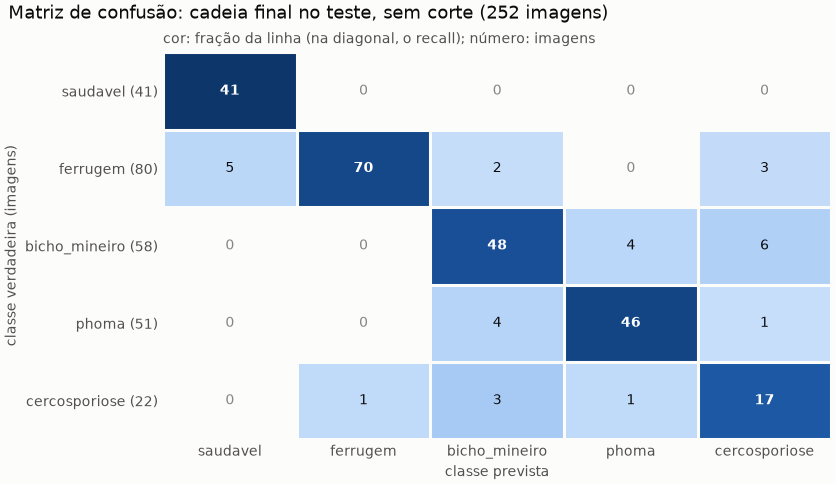
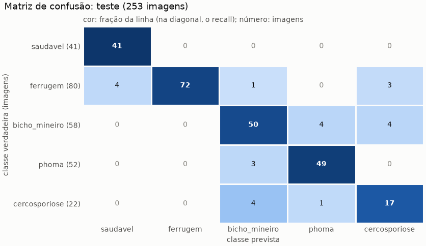

# Uso 1: teste do BRACOL (passo 7)

Gerado por `python model/teste_final.py --uso 1` em 14/10/2026 12:12. **Uso único e declarado dos testes**, com a cadeia congelada; nada foi ajustado nem escolhido por estes números. Início, fim, arquivos e SHA-256 em `model/runs/uso_do_teste_final.md`.

## Cadeia final (o resultado principal)

As 253 imagens de teste do BRACOL pela cadeia final inteira, no modo B, com o mesmo código do T1 da validação (`avaliar_pipeline.t1`). A cadeia decide o caminho de cada imagem: foto inteira (argmax com corte 0,61) ou detecção (duas etapas). A folha avaliada é a de maior área.

**Por caminho, teste contra validação** (validação: `model/runs/pipeline_final/metricas.json`):

| caminho | conjunto | imagens | acurácia sem corte | cobertura | acurácia das mantidas (IC 95%) | doentes chamadas saudáveis (IC 95%) |
|---|---|---:|---:|---:|---|---|
| foto inteira (regras 1 e 2) | teste | 192 | 90,1% | 91,1% | 93,1% (88,4% a 96,0%; 163 de 175) | 1,9% (0,7% a 5,5%; 3 de 156) |
| foto inteira (regras 1 e 2) | validação | 203 | 94,6% | 93,6% | 95,3% (91,2% a 97,5%; 181 de 190) | 0,0% (0,0% a 2,3%; 0 de 166) |
| recortes por detecção | teste | 60 | 81,7% | 83,3% | 84,0% (71,5% a 91,7%; 42 de 50) | 3,6% (1,0% a 12,3%; 2 de 55) |
| recortes por detecção | validação | 48 | 85,4% | 85,4% | 90,2% (77,5% a 96,1%; 37 de 41) | 6,8% (2,3% a 18,2%; 3 de 44) |
| todas | teste | 253 | 88,1% | 88,9% | 91,1% (86,7% a 94,2%; 205 de 225) | 2,4% (1,0% a 5,4%; 5 de 212) |
| todas | validação | 252 | 92,8% | 91,7% | 94,4% (90,6% a 96,7%; 218 de 231) | 1,4% (0,5% a 4,1%; 3 de 211) |

**Caminhos no teste:** regra 1 em 182 imagens, regra 2 em 10, detecção em 60 e regra 3 (sem folha) em 1. **A folha principal:** mantida em 225, descartada pelo corte em 27, tirada pelo filtro de fragmentos em 0 e sem folha em 1, de 253.

**Cadeia B, todas as imagens: teste contra validação.**

| conjunto | com previsão | acurácia sem corte (IC 95%) | F1 macro | recall saudavel | recall ferrugem | recall bicho_mineiro | recall phoma | recall cercosporiose | severidade: exata / ±1 | no corte: cobertura / acurácia |
|---|---:|---:|---:|---:|---:|---:|---:|---:|---:|---:|
| teste | 99,6% | 88,1% (83,5% a 91,5%) | 86,0% | 100,0% | 87,5% | 82,8% | 90,2% | 77,3% | 78,6% / 96,0% | 88,9% / 91,1% |
| validação | 99,6% | 92,8% (89,0% a 95,4%) | 91,6% | 97,6% | 93,7% | 87,9% | 94,1% | 90,9% | 75,3% / 95,6% | 91,7% / 94,4% |

Matriz de confusão da cadeia no teste, sem corte (linhas: verdadeira; colunas: prevista):

| classe verdadeira | saudavel | ferrugem | bicho_mineiro | phoma | cercosporiose |
|---|---:|---:|---:|---:|---:|
| saudavel | 41 | 0 | 0 | 0 | 0 |
| ferrugem | 5 | 70 | 2 | 0 | 3 |
| bicho_mineiro | 0 | 0 | 48 | 4 | 6 |
| phoma | 0 | 0 | 4 | 46 | 1 |
| cercosporiose | 0 | 1 | 3 | 1 | 17 |

Só as mantidas no corte (225): acurácia 91,1% (86,7% a 94,2%), F1 macro 88,8%.

| classe verdadeira | saudavel | ferrugem | bicho_mineiro | phoma | cercosporiose |
|---|---:|---:|---:|---:|---:|
| saudavel | 41 | 0 | 0 | 0 | 0 |
| ferrugem | 5 | 63 | 1 | 0 | 1 |
| bicho_mineiro | 0 | 0 | 42 | 3 | 3 |
| phoma | 0 | 0 | 2 | 46 | 1 |
| cercosporiose | 0 | 1 | 2 | 1 | 13 |

## O que o usuário recebe

`inferencia.diagnosticar` em cada uma das 253 imagens: sucesso: 231, erro: baixa_confianca: 21, erro: planta_nao_identificada: 1. Folhas por resposta de sucesso: {'1': 198, '2': 26, '3': 6, '4': 1}. Exceções: 0.

**Conferência com o T1:** planos diferentes em 0 imagens; nas 192 imagens da foto inteira, 0 divergências (folha que chega ou não, e a classe). Imagem inteira da cadeia contra o classificador sozinho: diferença máxima das probabilidades 6.7e-03 (o treino usou AMP), classe prevista igual em 253 de 253.

## Classificador sozinho, sem corte (só informação)

O caminho do `metricas_val.json` (`train.avaliar`, com AMP, época 14), na imagem inteira, sem cadeia nem corte.

- **Acurácia:** 90,5% (229 de 253 imagens; intervalo de Wilson de 95%: 86,3% a 93,5%).
- **F1 macro:** 88,5% (média simples do F1 das 5 classes).

| classe | imagens | precisão | recall | F1 |
|---|---:|---:|---:|---:|
| saudavel | 41 | 91,1% | 100,0% | 95,3% |
| ferrugem | 80 | 100,0% | 90,0% | 94,7% |
| bicho_mineiro | 58 | 86,2% | 86,2% | 86,2% |
| phoma | 52 | 90,7% | 94,2% | 92,5% |
| cercosporiose | 22 | 70,8% | 77,3% | 73,9% |

Matriz de confusão (linhas: classe verdadeira; colunas: classe prevista):

| classe verdadeira | saudavel | ferrugem | bicho_mineiro | phoma | cercosporiose |
|---|---:|---:|---:|---:|---:|
| saudavel | 41 | 0 | 0 | 0 | 0 |
| ferrugem | 4 | 72 | 1 | 0 | 3 |
| bicho_mineiro | 0 | 0 | 50 | 4 | 4 |
| phoma | 0 | 0 | 3 | 49 | 0 |
| cercosporiose | 0 | 0 | 4 | 1 | 17 |

**Severidade** (níveis 0 a 4; 253 imagens com alvo):

- MAE (em níveis): 0,233; kappa quadrático ponderado: 0,752.
- Acurácia exata: 80,6%; com tolerância de 1 nível: 96,0%.
- Imagens por nível verdadeiro: 0: 41, 1: 139, 2: 50, 3: 15, 4: 8.

**Teste contra validação e validação cruzada** (os mesmos números dos arquivos; a validação cruzada usa modelos de 20 épocas, mais fracos que o run base, nas 1.432 imagens de treino e validação):

| fonte | arquivo | imagens | acurácia (IC 95%) | F1 macro | recall saudavel | recall ferrugem | recall bicho_mineiro | recall phoma | recall cercosporiose |
|---|---|---:|---|---|---|---|---|---|---|
| teste | este run | 253 | 90,5% (86,3% a 93,5%) | 88,5% | 100,0% | 90,0% | 86,2% | 94,2% | 77,3% |
| validação | `model/runs/base_resnet50_bracol/metricas_val.json` | 252 | 94,8% (91,4% a 97,0%) | 93,2% | 97,6% | 97,5% | 93,1% | 96,2% | 81,8% |
| validação cruzada, protocolo por blocos (o CV realista) | `model/runs/diagnostico_blocos/metricas_blocos.json` | 1.432 | 89,9% (88,3% a 91,4%) | 87,2% | 98,7% | 89,6% | 86,6% | 95,6% | 70,4% |
| validação cruzada, protocolo aleatório | `model/runs/diagnostico_blocos/metricas_blocos.json` | 1.432 | 90,7% (89,1% a 92,1%) | 88,2% | 99,1% | 90,5% | 87,2% | 95,3% | 74,4% |

## Leitura

**O teste fica abaixo da validação, sem diferença sustentada, e perto da validação cruzada.**

- **Classificador sozinho (informação):**
  - Teste: 90,5% (86,3% a 93,5%), F1 macro 88,5%. Validação: 94,8% (91,4% a 97,0%), F1 macro
    93,2%. Os intervalos se sobrepõem (de 91,4% a 93,5%).
  - O teste fica perto da validação cruzada nas 1.432 imagens de treino e validação: 89,9% por
    blocos (F1 87,2%) e 90,7% pelo protocolo aleatório (F1 88,2%).
  - A validação de 252 imagens também escolheu a época do checkpoint (a de melhor F1 macro), o
    que tende a deixá-la otimista.
- **Cadeia final (o resultado principal):**
  - **Sem corte:** 88,1% (83,5% a 91,5%), contra 92,8% (89,0% a 95,4%) na validação. Os
    intervalos se sobrepõem.
  - **No corte:** ficam 225 das 253 imagens (88,9%), e 91,1% (86,7% a 94,2%) delas estão certas,
    contra 94,4% na validação.
  - **Contra o classificador sozinho:** a cadeia perde 2,4 pontos sem corte no teste (88,1% contra
    90,5%), perto dos 2,0 pontos da validação.
- **Por caminho:**
  - **Foto inteira (192 imagens):** 93,1% (88,4% a 96,0%) das mantidas estão certas.
  - **Detecção (60 imagens, contra 48 na validação):** 84,0% (71,5% a 91,7%), contra 90,2% na
    validação. Os intervalos se sobrepõem.
  - Em 45 das 60 imagens da detecção, o detector achou mais de uma folha numa foto de folha
    única (38 de 48 na validação).
- **Doentes chamadas saudáveis:** 5 de 212 (2,4%; 1,0% a 5,4%), contra 3 de 211 na validação.
  - 3 vêm da foto inteira (argmax) e 2 da detecção (duas etapas).
  - As 5 são ferrugem. No classificador sozinho, 4 ferrugens viram saudáveis.
- **O que o usuário recebe:**
  - 231 respostas de sucesso, 21 `baixa_confianca`, 1 `planta_nao_identificada` e nenhuma
    exceção.
  - 33 respostas trazem mais de uma folha, por causa das detecções extras na mesma foto.
  - **Conferência com o T1:** 0 divergências nas 192 imagens da foto inteira, e o plano foi igual
    em todas.
- **Por classe:**
  - A cercosporiose tem 22 imagens. O recall dela na cadeia (77,3%) oscila 4,5 pontos por
    imagem.
  - Os erros mais comuns da cadeia são bicho-mineiro previsto como cercosporiose (6) ou phoma
    (4), e ferrugem prevista como saudável (5).
- **Severidade:** 80,6% exata e 96,0% com ±1 no classificador sozinho; 78,6% e 96,0% na cadeia.
- **Nada foi ajustado** por estes números.

## Ressalvas

- **Phoma e cercosporiose:** A correspondência das colunas 'phoma' e 'cercospora' do dataset.csv (códigos 3 e 4 de predominant_stress) com as classes 'brown leaf spot' e 'cercospora leaf spot' de Esgario et al. (2020) ainda não foi confirmada. Aqui elas viram as classes 'phoma' e 'cercosporiose' do projeto. O mesmo vale para as pastas 'Phoma' e 'Cerscospora' do JMuBEN: viram 'phoma' e 'cercosporiose' sem confirmação de que nomeiam as mesmas doenças do BRACOL.
- **Cercosporiose: 22 imagens no teste.** Cada uma vale 4,5 pontos de recall dessa classe, que por isso oscila muito.
- **Comparação com Esgario et al. (2020):** a divisão é outra (ver `data/README.md`); os números não são diretamente comparáveis.

